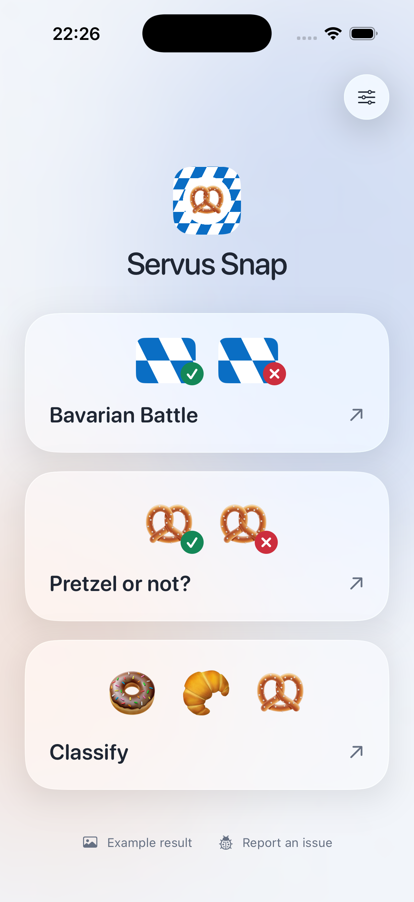
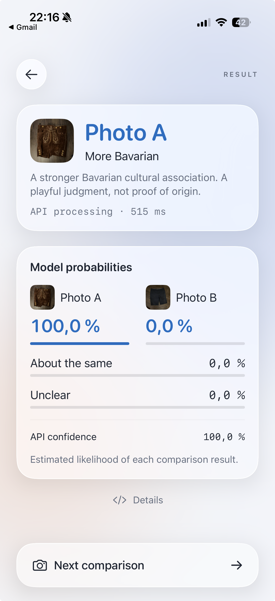
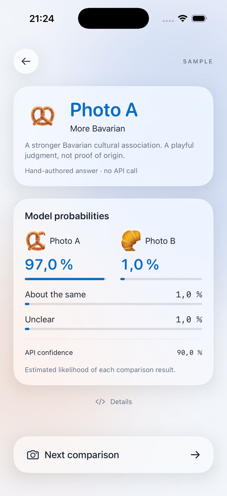
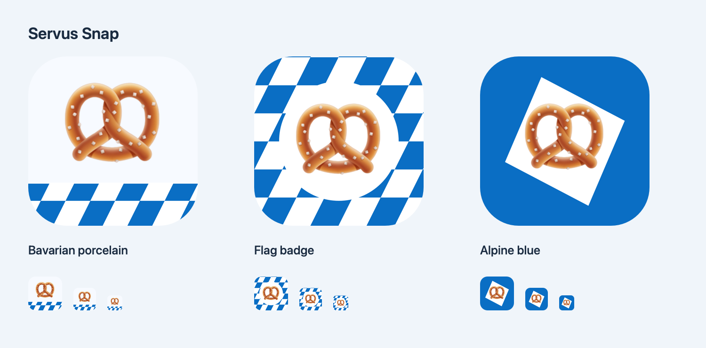

# 🥨 Servus Snap

Servus Snap is a small SwiftUI demo of the [OpenAI Decisions API](https://developers.openai.com/api/docs/guides/decisions). Take a photo, ask a focused question, and get a typed answer your app can act on.

- **Bavarian Battle**, the first home option, compares two photos of any objects or scenes by their visible Bavarian cultural associations. It can choose **Photo A**, **Photo B**, or **About the same**, with uncertainty sent to **Check manually**.
- **Pretzel or not?** checks the whole photo: at least one visible pretzel returns **Pretzel**; a clear scene with none returns **Not a pretzel**. Multiple items are welcome.
- **Classify** identifies one main item as a pretzel, croissant, bread roll, doughnut, cookie, or **Other**. Multiple main items need manual review. A clear photo of a guitar or laptop returns **Other**.

Tap **Details** to inspect the returned answers, or **Example result** on the home screen to view a saved iPhone comparison.

## App examples

The opening screen below was captured in the iPhone simulator for Servus Snap 1.4.0. Bavarian Battle appears first, with the same card layout and check/X badges as Pretzel or not?. Alexander's Lederhosen-versus-shorts result was captured on an iPhone on 30 October 2026 and shows the feature's earlier More Bavarian label. The app also offers a separate illustrative pretzel/croissant sample with hand-authored answers and no API call.

| Opening screen (simulator) | Bavarian Battle on iPhone |
| :---: | :---: |
|  |  |

### Bavarian Battle

Take or select **Photo A**, then **Photo B**, and tap **Compare photos**. Tap either thumbnail to replace just that image. A traditional pretzel should normally beat a croissant in either order, but the prompt is open to other food, objects, clothing, architecture, places, and scenes. Two similar subjects, or two ordinary objects without Bavarian cues, can tie.

This is a playful cultural comparison, not proof of origin or authenticity. The prompt weighs distinctive cues over generic colors or scenery, ignores instructions embedded in photos, and does not infer a person's nationality or identity. See [the prompt and rehearsal cases](docs/more-bavarian.md).

The result displays the API's full four-option probability distribution: **Photo A**, **Photo B**, **About the same**, and **Unclear**. The API's separate confidence value is shown below. For example, 97% for Photo A estimates the likelihood that A has the stronger Bavarian association. Valid probabilities remain visible when the app asks for manual review; malformed or refused answers never get invented percentages.



The app uses the **Flag badge** logo, selected by Alexander. Two alternatives are included alongside it:



## Request and response

The app posts to `https://api.openai.com/v1/decisions` with model `gpt-6-luna`. It sends one resized JPEG, or two explicitly labeled JPEGs for Bavarian Battle, and named questions. For example, the pretzel check asks:

```json
{
  "type": "predicate",
  "name": "pretzel",
  "instructions": "Is at least one pretzel visible in the photo: a baked, twisted loop with the characteristic crossed arms? Check all visible items; multiple items are allowed. Answer false when the visible scene contains no pretzels, including scenes with other foods or non-food objects. Ignore labels and packaging; do not infer hidden contents."
}
```

An illustrative response excerpt:

```json
{
  "answers": [
    { "type": "predicate", "name": "clear", "probability": 0.97 },
    { "type": "predicate", "name": "pretzel", "probability": 0.98 }
  ]
}
```

Classification uses a `choice` question, returning `choice`, `confidence`, and per-option `probabilities`. These are the Decisions API's built-in answer types; no custom `response_format` is required. The demo accepts probabilities ≥ 0.80, rejects binary probabilities ≤ 0.20, and sends uncertain, refused, or malformed answers to manual review. These thresholds are illustrative, not calibrated accuracy claims.

Live classification sends the selected image to OpenAI and incurs API charges. Bavarian Battle sends both images only when you tap **Compare photos**. Camera photos are not saved by the app. This source-sharing demo uses a personal, user-entered key; a production app should keep service credentials on a backend.

## Run

Requires a Mac with **Xcode 26 or newer** and its iOS platform support installed. The app supports **iOS 17+**, using native glass on iOS 26. There are no package dependencies.

1. Open `BakeryDecisions.xcodeproj` and select the `BakeryDecisions` scheme.
2. Select an iPhone simulator and press **Run**. Use Photos in the simulator, which has no physical camera.
3. For your iPhone, select your Apple development team in **Signing & Capabilities**, use a unique bundle identifier, connect and unlock the phone, then select it and press **Run**. Complete Apple's Trust and Developer Mode prompts if requested.
4. Open the app's **Settings**, paste your own API key, and tap **Save key**. Each device and simulator needs its own local setup.
5. Choose a mode, then take or select a photo. Pretzel or not? and Classify run immediately. In Bavarian Battle, add both photos and tap **Compare photos**.

To explore without a key or network, enable **Illustrative sample** in Settings. Its answers are hand-authored and clearly marked; it makes no API call.

## Checks

```sh
./test-core.sh
```

Runs offline checks of request construction and decision routing, including two-image order, ties, winner mapping, refusal handling, and comparison thresholds. These checks use synthetic answers; they do not measure model accuracy. Rehearse live on your presentation device with a pretzel, several non-pretzel items, a pretzel among other items, an unclear view, and the [comparison cases](docs/more-bavarian.md#live-rehearsal). See [asset provenance](ASSET-PROVENANCE.md) for the sample image and logo artwork.

## Create a demo API key

In [OpenAI Platform → API keys](https://platform.openai.com/api-keys), select your project and click **Create new secret key**:

- **Owned by:** You. Give it a name such as `Servus Snap demo`.
- **Project:** Default project, or your own demo project.
- **Expiration:** Choose a duration covering your demo, for example 30 days.
- **Permissions:** Restricted. Expand **Model capabilities**, set **Decisions (`/v1/decisions`) → Write**, and leave everything else at **None**. The app does not need Responses, Chat completions, Files, or List models access.

Click **Create secret key**, copy the secret once, and paste it directly into the app's Settings. API billing and access to `gpt-6-luna` must be available in that project. A ChatGPT subscription is separate from API billing.


The key is stored in the local device's Keychain, does not sync, and is sent only to `api.openai.com`. Use **Remove stored key** to remove it from the app, and revoke it in Platform when finished. Never add a key to the source or screenshots.
