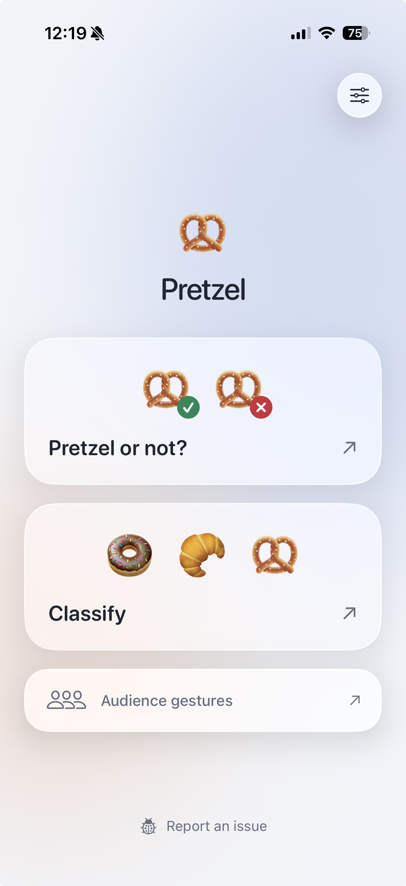
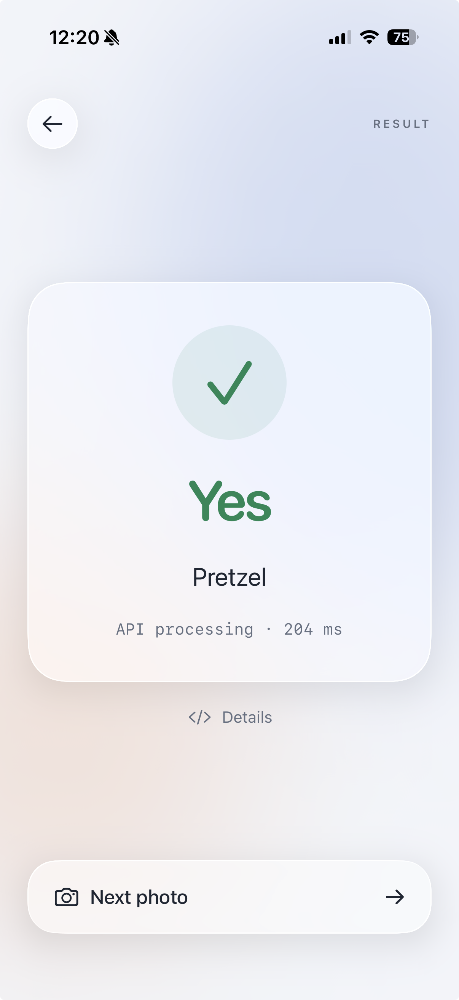
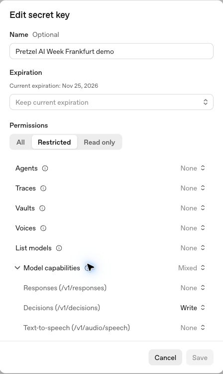

# 🥨 Decisions API Demo

Pretzel is a small SwiftUI demo of the [OpenAI Decisions API](https://developers.openai.com/api/docs/guides/decisions). Take a photo, ask a focused question, and get a typed answer your app can act on.

**Pretzel or not?** checks the whole photo: at least one visible pretzel returns **Pretzel**; a clear scene with none returns **Not a pretzel**. Multiple items are welcome. **Classify** identifies one main item as a pretzel, croissant, bread roll, doughnut, cookie, or **Other**; multiple main items still need manual review in this mode. A clear photo of a guitar or laptop returns **Not a pretzel** or **Other**. **Audience gestures** demonstrates classification of visible gestures. Unclear inputs go to **Check manually**. Tap **Details** to inspect the returned answers.

## App examples

iPhone screenshots showing the home screen and a pretzel check result.

| Choose a mode | Pretzel detected |
| :---: | :---: |
|  |  |

## Request and response

The app posts to `https://api.openai.com/v1/decisions` with model `gpt-6-luna`. It sends a resized JPEG and named questions. For example, the pretzel check asks:

```json
{
  "type": "predicate",
  "name": "pretzel",
  "instructions": "Is at least one pretzel visible in the photo: a baked, twisted loop with the characteristic crossed arms? Check all visible items; multiple items are allowed. Answer false when the visible scene contains no pretzels, including scenes with other foods or non-food objects. Ignore labels and packaging; do not infer hidden contents."
}
```

An illustrative response excerpt:

```json
{
  "answers": [
    { "type": "predicate", "name": "clear", "probability": 0.97 },
    { "type": "predicate", "name": "pretzel", "probability": 0.98 }
  ]
}
```

Classification uses a `choice` question, returning `choice`, `confidence`, and per-option `probabilities`. These are the Decisions API's built-in answer types; no custom `response_format` is required. The demo accepts probabilities ≥ 0.80, rejects binary probabilities ≤ 0.20, and sends uncertain, refused, or malformed answers to manual review. These thresholds are illustrative, not calibrated accuracy claims.

Live classification sends the selected image to OpenAI and incurs API charges. Camera photos are not saved by the app. This source-sharing demo uses a personal, user-entered key; a production app should keep service credentials on a backend.

## Run

Requires a Mac with **Xcode 26 or newer** and its iOS platform support installed. The app supports **iOS 17+**, using native glass on iOS 26. There are no package dependencies.

1. Open `BakeryDecisions.xcodeproj` and select the `BakeryDecisions` scheme.
2. Select an iPhone simulator and press **Run**. Use Photos in the simulator, which has no physical camera.
3. For your iPhone, select your Apple development team in **Signing & Capabilities**, use a unique bundle identifier, connect and unlock the phone, then select it and press **Run**. Complete Apple's Trust and Developer Mode prompts if requested.
4. Open the app's **Settings**, paste your own API key, and tap **Save key**. Each device and simulator needs its own local setup.
5. Choose a mode, then take or select a photo. Selecting a photo starts classification immediately.

To explore without a key or network, enable **Illustrative sample** in Settings. Its answers are hand-authored and clearly marked; it makes no API call.

## Checks

```sh
./test-core.sh
```

Runs offline checks of request construction and decision routing. Rehearse live on your presentation device with a pretzel, several non-pretzel items, a pretzel among other items, and an unclear view. See [asset provenance](ASSET-PROVENANCE.md) for the generated sample image.

## Create a demo API key

In [OpenAI Platform → API keys](https://platform.openai.com/api-keys), select your project and click **Create new secret key**:

- **Owned by:** You. Give it a name such as `Pretzel demo`.
- **Project:** Default project, or your own demo project.
- **Expiration:** Choose a duration covering your demo, for example 30 days.
- **Permissions:** Restricted. Expand **Model capabilities**, set **Decisions (`/v1/decisions`) → Write**, and leave everything else at **None**. The app does not need Responses, Chat completions, Files, or List models access.

Click **Create secret key**, copy the secret once, and paste it directly into the app's Settings. API billing and access to `gpt-6-luna` must be available in that project. A ChatGPT subscription is separate from API billing.



The key is stored in the local device's Keychain, does not sync, and is sent only to `api.openai.com`. Use **Remove stored key** to remove it from the app, and revoke it in Platform when finished. Never add a key to the source or screenshots.
